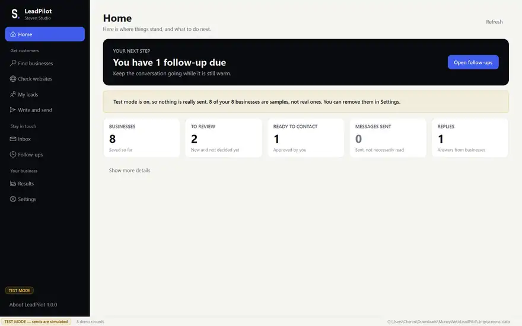
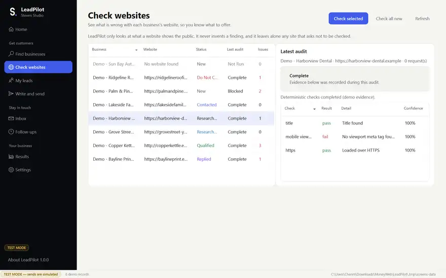
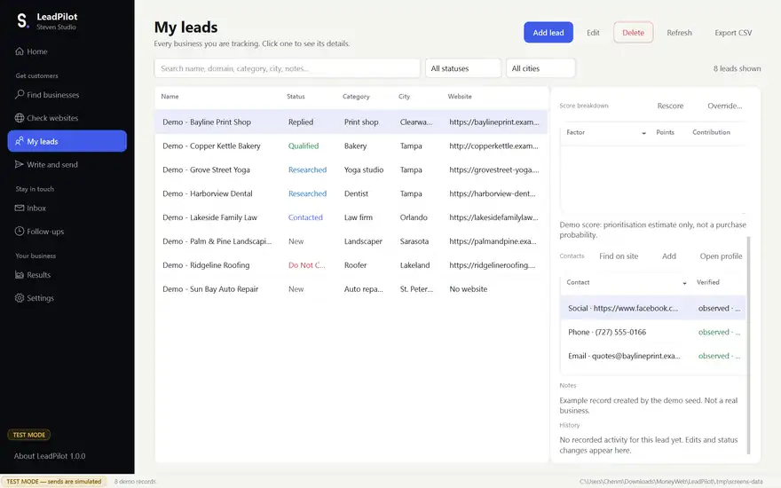
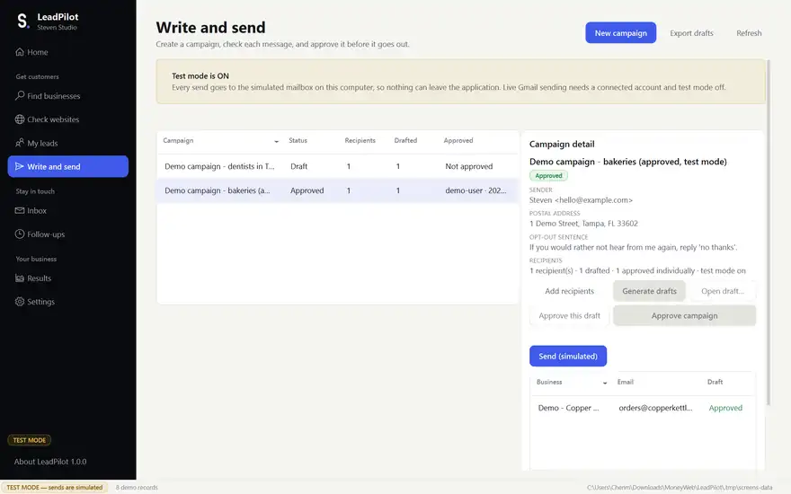

# LeadPilot

**A Windows desktop app that finds local businesses with weak websites, audits them, scores each lead, and runs human-approved, one-to-one email outreach.**

I built LeadPilot for my web design studio, [Steven C. Web Studio](https://stevencwebstudio.netlify.app), to find, research and contact potential clients in one guided pipeline.

> **Status:** v1.0.0 (Oct 2026), packaged as a Windows installer. 295 automated tests passing.
> Source code is private for now. Happy to walk through it on request.



---

## What it does

The app follows the same five steps a person would, with every step saved to a local database:

| Step | What happens |
|---|---|
| **1. Find businesses** | Searches OpenStreetMap (free), optional Google Places, or a CSV import with a column-mapping preview |
| **2. Check websites** | Read-only audit of each site (HTTPS, mobile viewport, title, meta description, contact and booking paths). Respects `robots.txt` and a strict request budget |
| **3. Score leads** | Transparent 4-factor score (website problems 40%, no website 20%, reachable contact 25%, profile completeness 15%), with the breakdown stored for every lead. Missing data is excluded, not penalized |
| **4. Write and send** | Drafts from templates or the Anthropic API, using only stored evidence. **Every message needs my approval** and is sent one at a time through Gmail |
| **5. Follow up** | Syncs replies, sorts them (Wants a demo / Interested / Not now / Stopped), handles opt-outs instantly, and suggests follow-up tasks |

A **Results** page tracks the full funnel: leads → researched → scored → contacted → replied → converted.

## Built to be responsible

Outreach tools are easy to misuse, so the guardrails are part of the design:

- **Test mode is on by default.** Nothing can leave the app until it is turned off and a Gmail account is explicitly connected.
- **No bulk or background sending.** Each message is approved individually and sent once.
- **Opt-outs are permanent.** Suppressions are stored separately, so deleting a lead can never undo an opt-out.
- **Contacts keep their source.** Every email or phone records where and when it was found, plus a confidence level. Guessed addresses are never used for live sending.
- **Secrets stay out of the code.** API tokens live in Windows Credential Manager, and the release package was scanned for secrets (0 hits).

## Tech stack

**Python 3.13** · **PySide6 (Qt)** desktop UI · **SQLite** with **SQLAlchemy 2** and **Alembic** migrations (15 tables) · **Pydantic** validation · **pytest** (295 tests) · **Ruff** lint and format · **PyInstaller** Windows packaging · Gmail API · Anthropic API · OpenStreetMap

## Architecture

Four layers, with dependencies pointing one way:

```
ui/ (PySide6)  ──►  application/ (use cases)  ──►  database/ (SQLAlchemy)  ──►  SQLite
                           │
                           └──►  domain/ (enums, normalization: no framework imports)
```

- The UI never touches the database directly, and the service layer never imports Qt.
- Long-running work runs on background threads (`QThread`) so the UI stays responsive.
- The schema is owned entirely by Alembic migrations, and the app refuses to start on a half-migrated database.

## Screenshots

All screenshots use the app's built-in demo data in test mode. No real businesses are shown.

| Check websites (audit evidence) | Lead detail (contacts with sources) |
|---|---|
|  |  |

**Write and send, with the approval gate**



## Testing and QA

- **295 automated tests** (pytest), using mocked or simulated providers so no real messages are sent.
- The packaged `.exe` was also driven end to end with Windows UI Automation: launch, navigation across all pages, data persistence, a real map search, and a clean shutdown while checks were running.
- Documented in a release report, a QA report and a test plan.

---

**Mingwei (Steven) Chen** · Information Science (Data Science & Analytics), University of South Florida
